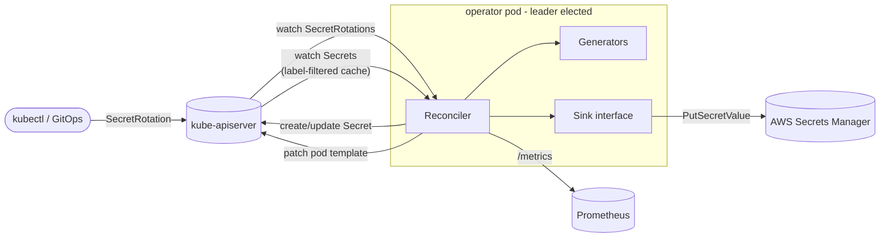

# secret-rotation-operator

A Kubernetes operator that generates and rotates Secrets on a schedule, rolls the
workloads that consume them, and mirrors each new version into AWS Secrets Manager.

Built with Go, [controller-runtime](https://github.com/kubernetes-sigs/controller-runtime),
and controller-tools. Tested against a real kube-apiserver with envtest, and on kind.

```yaml
apiVersion: rotation.nolankisser.github.io/v1alpha1
kind: SecretRotation
metadata:
  name: postgres-app-user
spec:
  secretName: postgres-app-credentials
  rotationInterval: 720h        # every 30 days
  keepPrevious: true            # old value kept as password.previous during rollout
  keys:
  - name: password
    generator: {type: Password, length: 40}
  - name: signing-key
    generator: {type: RSAKey, bits: 3072}
  restartTargets:               # rolled after every rotation
  - {kind: Deployment, name: api}
  sinks:
    awsSecretsManager:          # mirrored for consumers outside the cluster
      secretId: prod/postgres-app-user
```

```console
$ kubectl get secretrotations
NAME                SECRET                     INTERVAL   VERSION   READY   NEXT ROTATION          AGE
postgres-app-user   postgres-app-credentials   720h0m0s   3         True    2026-12-25T09:14:02Z   62d
```

## Features

- **Generators**: passwords (unbiased sampling via `crypto/rand`), random bytes (base64/hex), and RSA keys (PKCS#8 PEM).
- **Scheduled and on-demand rotation**: `kubectl annotate sr/<name> rotation.nolankisser.github.io/rotate-now=$(date +%s)`.
- **Zero-downtime handover**: `keepPrevious` keeps `<key>.previous` so a server can accept both credentials while clients roll.
- **Rolling restarts** of Deployments, StatefulSets, and DaemonSets via a pod-template annotation, which is the same mechanism as `kubectl rollout restart`.
- **AWS Secrets Manager sink** with idempotent writes and least-privilege IRSA (Terraform in [`terraform/`](terraform)).
- **Self-healing**: a Secret that is deleted or stripped of keys is regenerated immediately.
- **Deletion policy**: `Delete` garbage-collects the Secret with its owner; `Retain` orphans it through a finalizer.
- **Adoption**: an existing, unowned Secret with the same name is taken over and rotated. Secrets controlled by something else are never touched.

## Architecture



Each reconcile is **level-triggered**: it reads the current state and works out what to do from scratch.

1. **Decide**: rotate if the Secret is missing, unmanaged, overdue, or a new `rotate-now` token is present. Fill in only missing keys if the spec gained a key.
2. **Rotate**: write the new data *and* the rotation bookkeeping (version, timestamp, trigger token) to the Secret in one optimistic-concurrency update.
3. **Propagate**: stamp the version on each workload's pod template, and push to sinks that are behind.
4. **Report**: patch `status` and conditions (`Ready`, `WorkloadsRestarted`, `SinksSynced`), update metrics, and requeue for the exact time the next rotation is due.

## Design decisions

These are the interesting parts, and the questions I'd expect in a design review.

**The Secret is the source of truth, not `.status`.** Rotation state lives in annotations on the Secret and is written in the same API call as the new data. If the operator crashes between writing the Secret and updating status, the next reconcile still sees the right version and does not rotate twice. Status can be rebuilt from the Secret at any time.

**No double rotations under stale caches.** Updates carry `resourceVersion`, so a decision made from a stale informer cache fails with `409 Conflict` and retries from fresh state. Creates against a stale "not found" fail with `AlreadyExists`. Either way, the API server's optimistic concurrency guarantees correctness.

**A rotation never waits on downstream failures.** Workload restarts and sink pushes are gated on the version and are idempotent. If AWS is throttling or a target Deployment is missing, the Secret is still rotated, the failing step is retried with exponential backoff, and that condition goes `False`. Nothing is rotated twice.

**Idempotent external writes.** The Secrets Manager `ClientRequestToken` is derived from the SecretRotation UID and version. A retry after a crash, or after a push succeeded but the status write failed, is deduplicated by AWS instead of creating a new secret version.

**Bounded memory with a label-filtered cache.** By default, controller-runtime would cache *every* Secret in the cluster. The operator only caches Secrets labelled `app.kubernetes.io/managed-by=secret-rotation-operator`, and uses uncached reads for the rare lookup of an unlabelled Secret (adoption) and for workloads. This also limits what a compromised operator pod holds in memory.

**Validation at admission, no webhook.** OpenAPI and CEL rules in the CRD enforce a minimum interval, an immutable `secretName`, minimum password length, `bits` required for RSA keys, and unique key names. That avoids running a webhook along with its TLS certificates and availability risk.

**Several SecretRotations can target one workload.** The restart annotation key embeds a short hash of the SecretRotation name, so two rotations can't overwrite each other's marker and the key stays within the 63-character limit.

## Observability

| Metric | Type | Use |
| --- | --- | --- |
| `secret_rotation_rotations_total{reason}` | counter | Created / Scheduled / ManualTrigger / KeysMissing / Adopted |
| `secret_rotation_errors_total{stage}` | counter | generate / write / restart / sink |
| `secret_rotation_next_rotation_timestamp_seconds` | gauge | Alert when `time()` passes it: rotation is stuck |
| `secret_rotation_last_rotation_timestamp_seconds` | gauge | Credential age |
| `secret_rotation_secret_version` | gauge | Rotation counter |

controller-runtime's standard metrics (reconcile latency, queue depth, and so on) are also exposed. [`config/prometheus/`](config/prometheus) ships a `ServiceMonitor` and alerts: `SecretRotationOverdue`, `SecretRotationErrors`, and `SecretRotationReconcileErrorsHigh`. The operator emits Kubernetes Events for every rotation and failure (`kubectl describe sr <name>`). Metrics are served over HTTPS behind Kubernetes authn/authz.

## Quick start (kind)

```sh
kind create cluster
make docker-build IMG=secret-rotation-operator:dev
kind load docker-image secret-rotation-operator:dev
make deploy IMG=secret-rotation-operator:dev

kubectl apply -f config/samples/demo.yaml   # 2-minute interval + demo Deployment
kubectl get sr -w
kubectl get secret demo-credentials -o jsonpath='{.metadata.annotations}'
```

Or run the operator outside the cluster against your current kubeconfig: `make install run`.

### AWS Secrets Manager sink

```sh
cd terraform && terraform apply -var cluster_name=my-eks -var secret_name_prefix=prod/
kubectl -n secret-rotation-system annotate sa secret-rotation-controller-manager \
  eks.amazonaws.com/role-arn=$(terraform output -raw role_arn)
# then add --enable-aws-sink to the manager args
```

The IAM policy is scoped to secrets under one name prefix. The trust policy accepts only the operator's ServiceAccount.

## Testing

| Layer | Command | What it covers |
| --- | --- | --- |
| Unit | `make test` | Scheduling decisions, generators, sink idempotency, and the reconciler against a fake client with a **fake clock**, so a 30-day interval is tested in microseconds |
| Integration | `make test-integration` | Real kube-apiserver + etcd (envtest): CRD/CEL validation, label-filtered cache and adoption, owner watches, finalizers, and all `config/samples` dry-run against the schema |
| End to end | `make e2e` | kind cluster with the real image: rotation, rolling restart, manual trigger, self-healing, garbage collection |

CI ([`.github/workflows/ci.yaml`](.github/workflows/ci.yaml)) runs all three, plus golangci-lint and a check that generated code and manifests are up to date. Tagging `v*` builds a multi-arch image, signs it with cosign (keyless), attaches an SBOM and provenance, and publishes `install.yaml` to a GitHub release.

## Production hardening

- Two replicas with leader election (`ReleaseOnCancel` for fast handover), a PodDisruptionBudget, and topology spread.
- Distroless non-root image, read-only root filesystem, all capabilities dropped, `restricted` Pod Security.
- RBAC generated from code markers, with no `delete` on Secrets. Aggregated `edit`/`view` roles let namespace users manage SecretRotations without cluster-admin.
- HTTP/2 disabled on the metrics server (Rapid Reset CVE class).

## Project layout

```
api/v1alpha1/          CRD types, validation markers, generated deepcopy
cmd/                   manager entrypoint (flags, manager, cache config)
internal/controller/   reconciler, scheduling logic, metrics
internal/generator/    secret material generators
internal/sink/         Sink interface + AWS Secrets Manager implementation
config/                kustomize: CRD, RBAC, manager, Prometheus, samples
test/integration/      envtest suite
hack/e2e-kind.sh       kind end-to-end test
terraform/             IRSA role for the AWS sink
```

## Roadmap

- Two-phase rotation for databases (create the new user, verify it, then revoke the old one) through a pluggable `Rotator` interface
- More sinks: HashiCorp Vault, GCP Secret Manager
- Cron-style schedules and maintenance windows
- A `v1beta1` API with a conversion webhook
